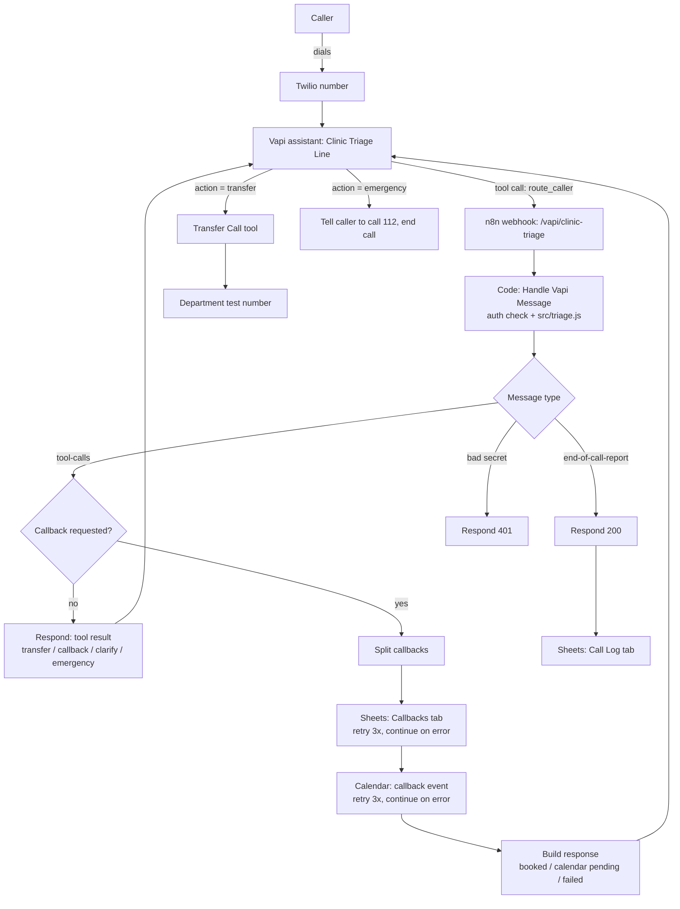
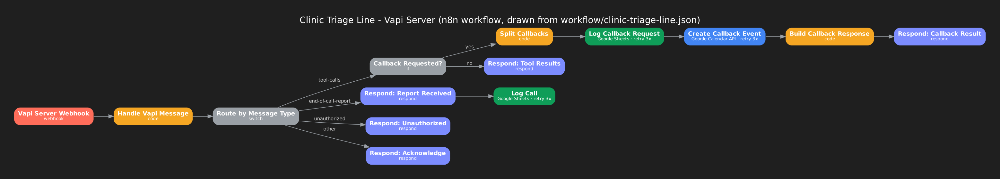
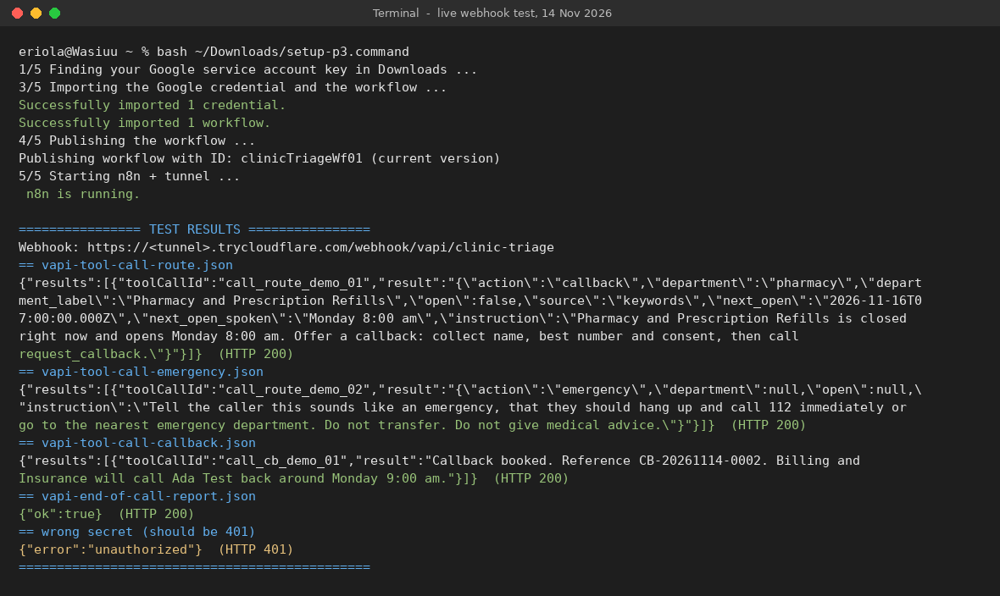

# Harbourview · Clinic Triage Line (AI Voice Agent)

> 🎥 **Loom demo (60–90s):** _LOOM_LINK_HERE_

An AI phone receptionist for clinics. It answers the call, works out **why** the patient is calling, and sends them to the **right department**: it transfers the call when that department is open and books a **callback** when it is closed. It **never gives medical advice**, and it sends anyone describing an emergency straight to emergency services.

---

## Problem

Clinic front desks are overloaded with calls that only need to be put through to the right place: a refill question for the pharmacy, a bill question for billing, a results question for the lab. Patients wait on hold, calls after hours go unanswered, and staff are pulled away from patients in the building. A generic phone menu ("press 1 for…") frustrates callers and misroutes them.

## Who it's for

- Small and mid-sized clinics, GP practices and outpatient centres with several departments sharing one phone line
- Agencies and freelancers who build voice automations for healthcare clients

## Features

- **Intent routing:** the caller speaks naturally; the assistant calls `route_caller`, which maps the reason to one of six departments (Appointments, Billing, Pharmacy, Lab, Records, Nurse Line). Unclear or mixed requests get one clarifying question.
- **Department transfer:** when the department is open, the call is transferred to its number with Vapi's Transfer Call tool (blind transfer through Twilio).
- **Callback request:** when the department is closed, the assistant says when it opens and offers a callback. It collects the name, reads the number back, records consent, and books it: a row in Google Sheets plus an event in Google Calendar, scheduled inside that department's opening hours. The caller gets a reference such as `CB-20261116-0002`.
- **Per-department opening hours** in the clinic's timezone (for example, the pharmacy is open on Saturday afternoons but the front desk is not).
- **Safety guard, no medical advice:** emergency and self-harm phrases are detected in code *before* any routing, even if the AI picked a department. The caller is told to hang up and call the emergency number. Symptom questions go to the Nurse Line (a human) and the assistant never answers them.
- **Call log:** every call's end-of-call report (summary, department, outcome, ended reason, duration) is logged with the caller's number masked.

## Stack

| Layer | Tool |
|---|---|
| Voice agent | Vapi (assistant + Function tools + Transfer Call + End Call) |
| Telephony | Twilio phone number imported into Vapi (or a free Vapi number) |
| Orchestration | n8n, self-hosted on a Mac, exposed with a free Cloudflare quick tunnel (one webhook workflow is the Vapi "server") |
| Scheduling | Google Calendar (callback events, via the Calendar API) |
| Log | Google Sheets (`Callbacks` and `Call Log` tabs) |
| LLM / voice | OpenAI `gpt-4o-mini` via Vapi, Deepgram transcriber, Vapi voice |
| Logic + tests | Plain JavaScript (`src/triage.js`), Node's built-in test runner |

## Tools used (free tiers)

Everything runs on free plans with no card on file.

| Brief says | Used here | Why |
|---|---|---|
| Vapi or Retell | Vapi (trial credit) | Function tools + Transfer Call + end-of-call reports to one server URL |
| n8n | **Self-hosted** n8n Community Edition on the developer's Mac + Cloudflare quick tunnel | The brief asks for self-hosted; the tunnel gives Vapi a public HTTPS URL for free. `scripts/start-n8n-local.command` sets it all up. |
| Google Calendar/GHL | Google Calendar + Google Sheets through a **Google service account** | Free; no OAuth redirect URL, so it keeps working when the tunnel URL changes. GHL was covered in P2. |
| Twilio | Optional | Needed only for a real phone number and PSTN transfers; browser test calls need no number |

**Tunnel note:** a Cloudflare quick tunnel gets a new URL each restart. Re-run `scripts/setup-vapi.js` (or `setup-vapi.command`) afterwards; it updates the same Vapi tools and assistant in place.

## Architecture



**Why the logic lives in code, not in the prompt:** the emergency check, department hours and callback validation decide what happens to a patient, so they're deterministic and tested (`tests/triage.test.js`). The LLM handles the conversation; the code makes the routing decision. `scripts/build-workflow.js` copies `src/triage.js` into the n8n Code node, so n8n runs exactly the tested code.

### Departments and hours (Africa/Lagos)

| Key | Department | Hours |
|---|---|---|
| `appointments` | Appointments and Front Desk | Mon–Fri 08:00–18:00, Sat 09:00–13:00 |
| `billing` | Billing and Insurance | Mon–Fri 09:00–17:00 |
| `pharmacy` | Pharmacy and Prescription Refills | Mon–Sat 08:00–20:00 |
| `lab` | Laboratory and Test Results | Mon–Fri 07:30–16:00 |
| `records` | Medical Records | Mon–Fri 09:00–16:00 |
| `nurse` | Nurse Line | Every day 08:00–20:00 |

Edit `DEPARTMENTS` in `src/triage.js`, then run `npm run build:workflow && npm run build:vapi`.

## Setup

**Requirements:** Node 18+, a Vapi account (free trial credit), an n8n instance (Cloud trial or self-hosted), a Google account, and optionally a Twilio trial account.

1. **Clone and test**
   ```bash
   npm test                      # 18 routing tests
   node scripts/simulate-n8n.js  # runs the generated n8n code on the sample payloads
   ```
2. **Start n8n:** run `bash scripts/start-n8n-local.command`. It downloads Node 24 and cloudflared into `local-n8n/` if needed, starts n8n and a Cloudflare quick tunnel, and prints the public editor and webhook URLs. Keep the window open.
3. **Google (free, no card):**
   - In Google Cloud, create a project, then **Enable** the Google Sheets API, Google Calendar API and Google Drive API. Skip the "$300 free trial"; none of this needs billing.
   - Create a service account and download its JSON key. Keep the key private; it's git-ignored.
   - Create a Google Sheet `Clinic Triage Line` with tabs `Callbacks` and `Call Log`, using the headers from `sample-data/*-sheet-template.csv`. Create a calendar `Clinic Callbacks`.
   - Share the sheet (Editor) and the calendar (Make changes to events) with the service account's email.
   - In n8n, create a **Google Service Account API** credential with the account's email and private key. Turn on *Set up for use in HTTP Request node*, with scopes `https://www.googleapis.com/auth/spreadsheets https://www.googleapis.com/auth/calendar.events https://www.googleapis.com/auth/drive.readonly`.
   - Build the workflow with your IDs: `GOOGLE_SHEET_ID=... GOOGLE_CALENDAR_ID=... VAPI_SHARED_SECRET=... node scripts/build-workflow.js`. Import `workflow/clinic-triage-line.json` into n8n, select the credential on the three Google nodes, then **Save** and **Publish**. Don't commit the filled-in export.
4. **Environment:** `cp .env.example .env` and fill it in. The department numbers must be **test numbers** (your own phone or teammates who agreed); on a Twilio trial they must also be Verified Caller IDs.
5. **Vapi:** create the tools and assistant in one step:
   ```bash
   node scripts/setup-vapi.js --dry-run   # check the payloads
   node scripts/setup-vapi.js             # creates/updates them, saves IDs to .vapi-ids.json
   ```
   Or create them by hand in the dashboard from `vapi/tools/*.json` and `vapi/assistant.json`.
6. **Phone number:** in Vapi, go to *Phone Numbers*, import your Twilio number (Account SID + Auth Token) or buy a free Vapi number, and set its assistant to **Clinic Triage Line**. You can also test without a number by clicking **Talk to Assistant** in the dashboard (web call).

### Test without a phone call

```bash
N8N_VAPI_WEBHOOK_URL=https://<your-n8n>/webhook/vapi/clinic-triage VAPI_SHARED_SECRET=<secret> \
  ./scripts/send-test-events.sh all
```

## Error handling

| Case | Behaviour |
|---|---|
| Caller describes an emergency or self-harm | Detected in code before routing; caller is told to call the emergency number; no transfer; call ends |
| Model picks a department that doesn't exist | Ignored; falls back to keyword routing or a clarifying question |
| Request is unclear or matches two departments equally | `clarify` action: one short question, then route again |
| Department closed | `callback` action with the next opening time, spoken naturally |
| Callback missing name, valid number, department or consent | Tool returns an `error` naming what's missing; the assistant asks for it |
| Google Sheets fails | 3 retries, then the tool returns an `error`; Vapi speaks the failure message and asks the caller to ring back in opening hours |
| Google Calendar fails | 3 retries; the callback is still logged in Sheets and confirmed to the caller as "calendar entry pending" |
| Transfer fails (number busy or unreachable) | Transfer tool's `request-failed` message: apologise and offer a callback |
| Malformed tool arguments or unknown tool | `error` result, HTTP 200 (as Vapi requires); never crashes the call |
| Request without the shared secret | HTTP 401, nothing processed |
| Other Vapi server messages | Acknowledged with `{}` |

## Data, privacy and safety

- **No medical advice.** The assistant only routes. It has no access to records or results, and the system prompt forbids it from interpreting symptoms, medicines or results.
- **Seed data only.** Sample callers are fictional ("Ada Test", +1 555-0100-1xx, a range reserved for fiction).
- **Test numbers only.** Department transfer numbers are the developer's own or opted-in testers; on a Twilio trial they must be verified.
- **Consent.** A callback is booked only after the caller agrees (`consent_to_callback = true`).
- **Minimal data.** Callers' numbers are masked in the call log; the callback row stores only name, number and a short non-clinical reason.
- **No secrets committed.** Keys live in `.env` (git-ignored), n8n credentials and Vapi.
- This is a demo, not a certified medical device. A real deployment needs the clinic's privacy/HIPAA/NDPR review and a BAA/DPA with each vendor.

## Screenshots

**n8n workflow** (drawn from the exported `workflow/clinic-triage-line.json`: red = trigger, orange = code, green = Google Sheets, blue = Google Calendar API, purple = webhook responses)



**Live run against the self-hosted n8n webhook, 14 Nov 2026** (the Terminal output re-rendered as an image; full log in [`docs/recorded-run/RUN_LOG.md`](docs/recorded-run/RUN_LOG.md)). At 20:27 on a Saturday the pharmacy is closed, so the refill call gets a callback offer; the emergency is redirected to 112; the callback is booked in Sheets and Calendar; the call report is logged; and a wrong secret gets 401.



## Testing

- `npm test`: 18 unit tests (emergency guard, intents, hours, clarify, callbacks, phone normalisation, Vapi payload handling, failure paths)
- `node scripts/simulate-n8n.js`: runs the generated n8n Code nodes against `sample-data/`
- [`docs/TEST_CHECKLIST.md`](docs/TEST_CHECKLIST.md): webhook and live-call checklist
- [`docs/recorded-run/RUN_LOG.md`](docs/recorded-run/RUN_LOG.md): recorded run against the live webhook

## Repo structure

```
src/triage.js                     routing logic (single source of truth)
tests/triage.test.js              unit tests
workflow/clinic-triage-line.json  n8n workflow export (generated)
vapi/assistant.json               Vapi assistant (placeholders filled by setup script)
vapi/tools/*.json                 route_caller, request_callback, transferCall, endCall
vapi/system-prompt.md             assistant instructions
scripts/build-workflow.js         src -> n8n workflow
scripts/build-vapi-config.js      src + prompt -> Vapi JSON
scripts/setup-vapi.js             create/update tools + assistant via the Vapi API
scripts/simulate-n8n.js           run the n8n code locally
scripts/send-test-events.sh       fire sample Vapi messages at n8n
sample-data/                      fictional payloads + sheet templates
docs/                             test checklist, recorded run, screenshots
.env.example                      every variable used
```
